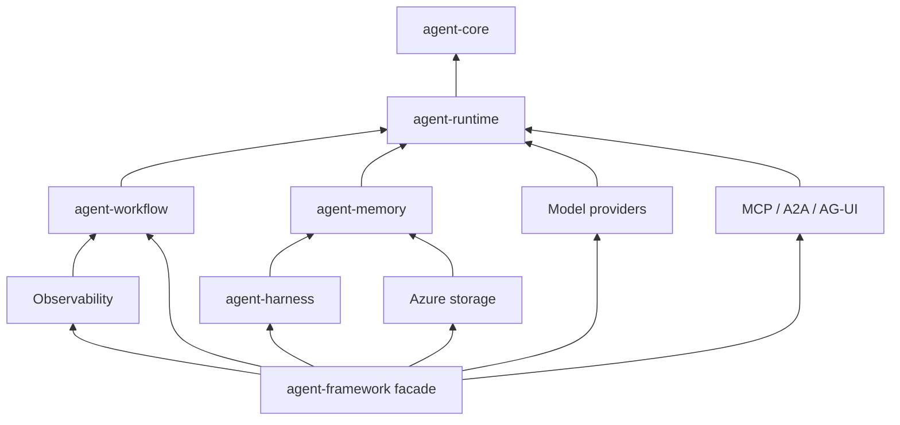

# Rust migration plan

Prepared 27 October 2026. Status: proposed implementation roadmap.

Implementation has started in the root workspace. See [current P0/P1 status](docs/migration/status.md) for completed work, validation evidence, and remaining phase gates. The baseline observations below describe the original planning snapshot.

Build a native Rust SDK in this repository root, using `temp/agent-framework-go` as the behavioral reference. Preserve the reference copy throughout the migration. Deliver a small, usable agent SDK first, then expand to the Go implementation's workflows, persistence, providers, and integrations through explicit parity gates.

The objective is equivalent supported behavior with an idiomatic Rust API. Matching Go identifiers, reproducing its reflection machinery, or claiming parity with the entire .NET/Python Microsoft Agent Framework is not the objective.

## 1. Baseline and scope

### What was inspected

The root currently contains only `temp/`. There is no Rust workspace and neither the root nor the supplied Go directory exposes Git repository metadata. A source commit cannot be established from this copy. Treat it as a source snapshot until its origin is verified.

The snapshot declares module `github.com/microsoft/agent-framework-go` and Go `1.26.0`. Locally available tools report Rust/Cargo `1.99.1` and Go `1.27.3`; these observations are not a decision about the Rust minimum supported version.

Static inventory, including nested tooling, examples, generated code, and tests:

| Source area | Go files | Test files included | Main responsibility |
| --- | ---: | ---: | --- |
| `message` | 19 | 8 | Messages, multimodal content, annotations, filtering, workflow message adapters |
| `agent` | 88 | 38 | Agent lifecycle, sessions, middleware, structured output, harness, memory, skills, compaction |
| `tool` | 23 | 8 | Tool contracts, typed function tools, hosted tools, MCP, shell execution |
| `embedding` | 8 | 4 | Embedding types, generators, batch and binding helpers |
| `vectordata` | 33 | 12 | Typed/dynamic collections, filters, search, in-memory connector |
| `provider` | 93 | 44 | Model/service/protocol adapters and observability |
| `workflow` | 102 | 46 | Graphs, execution, state, checkpoints, agent orchestration |
| `internal` | 58 | 12 | Runtime helpers, file stores, telemetry, generated Foundry client |
| `examples` | 139 | 1 | Tutorials, demos, end-to-end integrations |
| `cmd` | 14 | 4 | Example verification tools |
| `_catalog` | 27 | 3 | Separate Go module for .NET/Go API and test mappings |
| **Total** | **604** | **180** | Counts describe files, not test cases or coverage |

There are approximately 201,000 nonblank Go source lines including tests and generated code. This is a substantial SDK rewrite; file counts are not an effort estimate. Source inspection was selective and targeted at architecture and difficult contracts. No Go test suite, cloud call, or Rust implementation was run for this planning task.

The accompanying [source baseline](docs/migration/source-baseline.json) records a content fingerprint and inventory of this local copy. The fingerprint identifies local bytes; it does not establish an upstream commit or authenticity.

### Evidence to use

- Primary behavioral evidence: implementation and assertions in the adjacent Go test files.
- Package documentation: useful for intent, checked against code.
- `docs/agent-harness.md`: particularly useful for middleware order, default configuration, and ownership of tool execution.
- `_catalog/dotnet-go-sdk-symbol-mapping.json`: useful secondary context for upstream concepts, not a Rust parity specification. Its accompanying guide explicitly distinguishes symbol correspondence from behavior.
- `README.md`: introductory context only. It advertises text-search/RAG support, while its preview paragraph also says RAG is unavailable. The `agent/textsearch`, `agent/memory`, and RAG example code exists and belongs in this migration's inventory.

### Proposed product boundaries

| Release gate | Required outcome |
| --- | --- |
| **M1: usable agent SDK** | Messages, streams, sessions/history, middleware, typed tools, approval pause/resume, structured output, OpenAI Responses and Chat adapters, credential-free examples and tests |
| **M2: orchestration SDK** | In-process graph execution, sequential/concurrent/group-chat patterns, human input, checkpoint/restore, subworkflows, agent/workflow adapters |
| **M3: extensible SDK** | Harness, skills, shell tools, compaction, embeddings/vector search/memory, Azure/Foundry/Anthropic/Gemini, MCP, A2A, AG-UI, Copilot, observability |
| **M4: declared Go parity release** | Every in-scope Go behavior and example mapped, implemented, and validated; any exclusions explicitly listed and approved as a scope change |

M1 through M3 are intermediate releases. A missing adapter is still outstanding work toward M4, even if the Rust core is already useful. Calling a release "full parity" requires completing the declared scope, not merely compiling all crates.

Not initially in scope: capabilities absent from this Go baseline, such as declarative agents, DevUI, Foundry-hosted deployment, and handoff orchestration as described by its README; a distributed workflow engine; language bindings; WASM/no-std support; replacing every third-party Go dependency with an equivalent Rust implementation. Review actual code before finalizing each absence claim in phase 0.

Default assumptions: native server/CLI SDK, Windows and Linux first with macOS CI, Tokio runtime, no existing Go application data requiring automatic import, and OpenAI as the first transport implementation. These are planning choices. If Azure/Foundry is the first consuming application, promote its adapter work after the shared contracts are stable.

## 2. Root repository layout

Use a Cargo workspace at `C:\dev\agent-framework`, with a small public facade and independently testable crates. The Go copy stays at its existing path as reference material. Create crates incrementally when their phase starts rather than generating empty packages for everything on day one.

```text
agent-framework/
  Cargo.toml                    # workspace, shared dependencies/lints
  Cargo.lock                    # reproducible workspace and example builds
  rust-toolchain.toml            # selected stable compiler plus fmt/clippy
  README.md                     # Rust quick start and actual support status
  RUST_MIGRATION_PLAN.md
  LICENSE
  THIRD_PARTY_NOTICES.md
  .github/workflows/             # new Rust CI, not copied Go automation
  crates/
    agent-framework/            # facade/re-exports and optional features
    agent-core/                 # messages, tools, request/response contracts
    agent-runtime/              # Agent, sessions, history, middleware, tool loop
    agent-workflow/             # graph, scheduler, state, checkpoints, adapters
    agent-harness/              # composition, approval policies, skills, modes
    agent-memory/               # embeddings, vector abstractions, RAG, compaction
    agent-provider-openai/
    agent-provider-foundry/
    agent-provider-anthropic/
    agent-provider-gemini/
    agent-provider-copilot/
    agent-store-azure/          # AI Search and Cosmos history/storage surfaces
    agent-mcp/
    agent-a2a/
    agent-agui/
    agent-observability/
    agent-test-support/         # scripted provider, fake clock/transport, fixtures
  examples/                     # workspace package(s), explicit example targets
  tests/
    conformance/                # JSON scenarios and expected observable outcomes
    integration/                # explicit test package/targets, including live tests
  tools/
    go-oracle/                  # separate module; local replace to the Go reference
    xtask/                     # workspace task runner and parity validation
  docs/
    migration/
      source-baseline.json
      parity.json              # authoritative behavior/test/example ledger
      provider-capabilities.md
      compatibility.md
    adr/
  temp/
    agent-framework-go/        # preserved reference; excluded from Rust packages
```

Crate names are working names; check registry availability before publication. A virtual workspace does not automatically discover root-level integration tests: put executable tests in a workspace test package or configure explicit targets. Apply the same rule to examples.

Dependency direction must remain acyclic:



Low-level crates expose hooks; they never import the observability implementation or concrete providers. Runtime owns the context/history extension traits; memory implements them. Harness takes user-supplied components and produces configuration; it must not pull every provider into the core. Split the memory crate further only if actual dependency or compilation costs justify it.

Cargo workspaces support shared dependencies, metadata, lockfiles, and workspace commands; use those facilities to keep crate versions aligned. [Cargo workspace reference](https://doc.rust-lang.org/cargo/reference/workspaces.html)

## 3. Proposed architecture decisions

These decisions are proposed, not already accepted or implemented. Capture them as individual ADRs during phase 0; the project owner is the decider. Each ADR should contain context, options, trade-offs, consequences, and validation evidence.

| ADR | Decision proposed | Alternative considered | Consequence / validation |
| --- | --- | --- | --- |
| 001 | Behavioral rewrite in a Rust workspace | Literal port; Go library behind FFI/sidecar | More up-front design, native ownership and deployment; prove a complete agent/tool/session slice |
| 002 | Tokio execution with runtime-neutral model types | Runtime-generic I/O; synchronous-first API | Simpler transport/task lifecycle; document runtime requirement and avoid creating nested runtimes |
| 003 | Object-safe provider/tool/executor boundaries with boxed futures/streams | Fully generic public Agent; native async methods on dynamic traits | Easier heterogeneous agents and middleware; some allocation/dispatch overhead to benchmark |
| 004 | Closed standard content variants plus an unknown/raw escape hatch | Everything as JSON; arbitrary trait objects for all content | Useful Rust matching without losing provider extensions; custom serialization fixtures required |
| 005 | Explicit typed state codecs and stable schema IDs | Serialize `Any`, Rust `TypeId`, or Rust type names | Reliable restore across processes/builds; users register codecs for custom durable state |
| 006 | One tool-execution owner per provider invocation | Layer an independent harness loop on every provider | Prevents duplicate calls; test local and provider-managed execution separately |
| 007 | Native Rust persistence format, optional later Go importer | Byte-compatible Go sessions/checkpoints everywhere | Smaller core and clearer versioning; cross-language persisted-state migration remains a separate deliverable |
| 008 | Small first-party HTTP adapters behind framework contracts | Expose vendor SDK models publicly; require every vendor's SDK | Avoids SDK coupling; transport/schema maintenance becomes our responsibility |
| 009 | Explicit capabilities and feature-gated integrations | One universal provider API that silently ignores unsupported settings | More capability checks, fewer misleading successes; negative capability tests required |
| 010 | Explicit shutdown and per-run cancellation | Rely on garbage collection analogues or detached tasks | More lifecycle API surface; deterministically release clients, subprocesses, and background tasks |

### ADR-001 detail: rewrite strategy

**Status:** Proposed. **Date:** 27 October 2026. **Decider:** project owner.

**Context:** The source has mature behavioral tests, Go-specific reflection and iterator APIs, substantial workflow state, and many external integrations. The intended deliverable is a Rust SDK rooted in this folder.

| Option | Complexity | Delivery cost | Runtime/deployment | API fit |
| --- | --- | --- | --- | --- |
| A. Literal file-by-file translation | Initially familiar, difficult at language boundaries | Hidden rework in reflection, locks, lifetimes | Native Rust once complete | Often awkward and overuses shared mutable state |
| B. Native contracts plus behavior-driven implementation | More early design; bounded subsystem work | Early investment in fixtures reduces regression cost | Native Rust | Strong fit for traits, enums, ownership, and async streams |
| C. Rust wrapper around Go service/FFI | Small initial Rust surface | Continued dual-runtime maintenance | Requires Go artifacts/process coordination | Useful bridge but does not complete the rewrite |

**Decision proposed:** B. Use Go only as a development-time reference/oracle. Neither the published Rust crates nor their normal test suite should need Go.

**Consequences:** Public names and composition differ from Go. Behavior must be documented separately from syntax. Some Go conveniences, especially reflected tool functions and runtime type discovery, require explicit Rust builders and registered codecs. Upstream updates need triage against a pinned baseline instead of automatic translation.

**Actions:** establish the baseline and ledger; compile an API spike; execute a fake-provider tool turn; validate restoration in a fresh process; revisit if dynamic dispatch or codec ergonomics prove impractical.

## 4. Rust contracts to settle before large-scale porting

### Messages and responses

- Represent roles, source information, messages, content, annotations, tool calls/results, approval requests/responses, usage, and finish reasons explicitly. Allow unknown role/reason strings where the Go contract is open-ended.
- Cover text, reasoning content, bytes/media types/data URIs, URI content, hosted files/vector stores, native MCP content, errors, and raw content. Metadata is structured JSON; runtime-only provider objects belong in a separate nonserialized extension slot.
- Preserve unknown content/annotation discriminators and fields through round trips. `#[serde(other)]` alone loses payloads and is insufficient. Use a discriminator-aware codec with a raw fallback.
- Specify missing versus null versus empty values. `Option<T>` is sufficient only where missing and null have the same semantics; use a tri-state wrapper where an explicit clear differs from an absent update.
- Keep `ResponseUpdate` as a composite update: a single Go update can carry content, IDs, metadata, and continuation information together. Do not flatten it into mutually exclusive events that lose information.
- Implement response accumulation once. Port message-ID merging, role/author boundaries, timestamp rules, per-message versus response properties, usage accounting, and text/reasoning coalescing from `agent/response_test.go`.
- Retain tool-call IDs and assemble streamed argument fragments before parsing. Reject invalid/incomplete arguments before execution.
- Public streaming returns `Stream<Item = Result<ResponseUpdate, AgentError>>`; collection is a convenience over that stream. Decide and test how already-emitted partial output is represented when collection fails.

### Dynamic async boundaries

Proposed shape for the phase-0 spike, not a finished or compiled API:

```rust
pub type UpdateStream =
    Pin<Box<dyn Stream<Item = Result<ResponseUpdate, AgentError>> + Send + 'static>>;

pub trait ModelProvider: Send + Sync {
    fn capabilities(&self) -> ProviderCapabilities;

    fn run(
        &self,
        context: RunContext,
        request: ModelRequest,
    ) -> BoxFuture<'_, Result<UpdateStream, AgentError>>;
}
```

Here `Pin`/`Box` come from the standard library and `Stream`/`BoxFuture` from the selected futures crates. Framework request/context/error types remain to be designed. The returned stream owns its request and cloned client handles; it does not borrow a temporary builder. Use the same ownership pattern for long-lived workflow streams. Keep generic convenience methods outside traits used as `dyn` objects.

Native `async fn` trait methods are not dyn-compatible under the Rust reference's dispatch rules. Use explicit boxed futures or a consciously selected async-trait expansion at these boundaries; do not design `Arc<dyn ModelProvider>` around unboxed native async methods. [Rust trait reference](https://doc.rust-lang.org/reference/items/traits.html#dyn-compatibility)

### Cancellation, backpressure, and resource ownership

- `RunContext` carries cancellation, deadline, correlation IDs, and run-scoped dependencies. Use child cancellation tokens per run so cancelling one invocation cannot cancel an unrelated run.
- A run owns every task it spawns. Normal completion, failure, consumer drop, explicit cancellation, and process shutdown each have a tested cleanup path.
- Poll-based streams should avoid background work when possible. If producers need tasks, use bounded channels and a supervisor/handle that owns joins; dropping a Tokio join handle must not be treated as task cancellation.
- Provide explicit async cancellation/shutdown when waiting for cleanup matters. `Drop` can request cancellation but cannot await flushing history or joining a process. Define which commits are guaranteed at normal completion versus interruption.
- Backpressure must limit queued chunks and concurrent tool/executor work. A slow or abandoned consumer must not create an unbounded queue or leave a workflow running invisibly.
- Do not hold a session/state lock while awaiting provider, tool, or user code. Snapshot state or use short commits with revision checks.
- Blocking scripts/CPU-heavy vector work need bounded blocking execution; aborting an async handle does not necessarily stop a blocking closure. Subprocess cancellation must terminate and reap its process tree on each supported OS.

Tokio's shutdown guidance separates detecting shutdown, notifying work, and waiting for completion; apply that lifecycle at agent and workflow boundaries. [Tokio graceful shutdown](https://tokio.rs/tokio/topics/shutdown)

### Tools, schemas, and approval binding

- Expose a dynamic tool trait plus a generic typed-tool constructor using serializable input/output types and explicit JSON Schema support. Start with builders; add a procedural macro only after the nonmacro API is stable.
- Schema generation and argument validation are separate steps. Validate against the supported dialect before invoking a tool. Preserve Go behavior for extra fields, no-argument tools, scalar wrapping, and errors where applicable; record language-specific deviations such as nil-pointer handling.
- Separate locally executable functions from hosted provider tools. Capability checks must reject unsupported hosted tools before sending a request.
- Represent tool execution ownership explicitly: framework-owned or provider-owned. For provider-owned execution, decorate the supplied tools with middleware and let the provider invoke them. Do not also invoke them in the framework loop.
- Maintain one framework tool loop with limits, cancellation, optional bounded parallelism, deterministic call/result correlation, and consistent errors. Preserve the observed default of 40 iterations and the distinction between an unspecified limit and an explicit zero, unless an ADR records a deliberate change.
- Approval state records the issued request and exact bound call. Reject forged pairs, modified arguments, ambiguous/colliding IDs, cross-session approvals, and replayed execution. Pending approvals must survive save/load and unrelated turns.
- Reproduce streaming behavior around approvals: some call content is buffered until the approval requirement is known. Approval middleware is not permission to discard the underlying tool's approval requirement.
- Never retry a side-effecting tool automatically merely because the surrounding model request failed.

`schemars` derives JSON Schemas from Rust types, making it a candidate for typed tools. Pin and test its output against each provider's schema subset; generated schema validity does not itself establish provider compatibility. [Schemars documentation](https://docs.rs/schemars/latest/schemars/)

### Agent lifecycle, middleware, and history

- Keep agent-level, provider-call, and function-invocation middleware separate. Document nesting, ordering, short circuiting, retries, errors, and completion callbacks.
- Keep history providers distinct from additional context providers. Match per-run versus per-service-call persistence, notification boundaries, history conflict policy, and input immutability.
- Distinguish local conversation history, service-managed conversation IDs, and background/continuation tokens. A real service conversation ID is not a local session ID.
- Model continuation as an opaque provider value plus versioned framework state where needed. Handle resume/poll without reinjecting context or duplicating already-persisted input. Treat tokens as sensitive, bounded input.
- Agent configuration is immutable after construction. Session state is independently owned and synchronized. Proposed default: serialize turns within the same session and allow concurrency across sessions; record and test any difference from Go's supported concurrent access rather than assuming lock safety implies conversational correctness.
- Provide typed state keys/codecs over versioned serialized values. Runtime-only dependencies and raw SDK values are never silently serialized.
- Mid-run message injection requires a defined boundary between provider calls and consistent persistence. A queued injection must not appear in another session accidentally.

### Workflows and checkpointing

- Recreate the Go graph engine's superstep/turn-token semantics, not just an asynchronous DAG executor. Graphs may contain loops, conditions, fan-out/fan-in barriers, external requests, and subworkflows.
- Separate immutable graph definitions from per-run executor instances, state scopes, queued messages, and pending requests. Shared executor instances need an explicit concurrency capability; default to per-run factories for mutable executors.
- Build a single-owner scheduler first. Add bounded concurrency where the graph permits it, while preserving deterministic routing and barrier semantics. Compare causal event order rather than incidental cross-task wall-clock order.
- Typed builders should validate port compatibility. At dynamic dispatch/persistence boundaries, use explicit stable schema IDs and versioned payload codecs. Never persist Rust `TypeId`, memory addresses, or compiler-specific type names.
- A checkpoint includes graph identity/version, serializer version, run/session identity, parent checkpoint, step position, executor/private/shared state, queued messages, fan-in buffers, pending requests, and nested workflow state needed for resumption.
- Restore only at a safe boundary. Validate the graph/schema/codec registry before mutation, then replace state atomically. Reject unknown versions or missing codecs clearly.
- Preserve parent lineage, branching/time-travel behavior, request republishing policy, executor checkpoint/restore hooks, output tags, and removal of stale queued responses.
- File stores need atomic replacement, corruption detection, concurrent-write policy, and platform-specific verification. Do not claim that renaming a file alone guarantees durable persistence on every platform.
- Checkpoints do not provide exactly-once external side effects. Use operation IDs/idempotency where available; document replay behavior and require reconciliation for operations whose outcome is unknown after a crash.
- Expose workflow-as-agent and agent-as-executor adapters once both underlying lifecycles are stable. Group chat and handoffs are different concepts; do not claim handoffs because group chat exists.

## 5. Source-to-Rust migration map

| Go source | Proposed Rust destination | Behavior that must be retained | First phase |
| --- | --- | --- | --- |
| `message/message.go`, `content.go`, `annotation.go`, `datacontent.go`, `datauri.go` | `agent-core::message` | Content/metadata preservation, clone isolation, serialization and media handling | P1 |
| `message/messagefilter` | `agent-core::message::filter` | Ordering, source filtering, union/deduplication semantics | P1 |
| `agent/response.go`, `options.go`, `format/jsonformat` | Core response/options/schema; runtime helpers | Update folding, option precedence, strict structured output | P1–P3 |
| `agent/agent.go`, `session.go`, `history.go`, `context.go`, `middleware.go` | `agent-runtime` | Lifecycle and session/history contracts | P2 |
| `agent/continuation.go`, `messageinjection.go` | `agent-runtime` | Resume/poll and between-call injection | P2–P3 |
| `tool/tool.go`, `tool/functool`, `tool/hostedtool` | Core tool traits; runtime typed tools | Typed validation, result conversion, hosted capabilities | P1–P3 |
| `agent/harness/toolautocall`, `toolapproval` | Runtime tool loop; harness policy composition | Exactly one execution owner, limits, approval binding | P2 |
| `provider/openaiprovider` | `agent-provider-openai` | Responses, Chat, embeddings, streaming, schema conversion | P3/P6 |
| `workflow` and `workflow/internal/execution` | `agent-workflow::{graph,runtime}` | Ports, routing, supersteps, state and events | P4 |
| `workflow/checkpoint`, `workflow/internal/checkpoint`, `workflow/inproc` | `agent-workflow::{checkpoint,inproc}` | Save/restore, lineage, concurrency and lifecycle | P5 |
| `workflow/agentworkflow`, `message/messageworkflow` | `agent-workflow::agents` | Sequential/concurrent/group chat, turn accumulation and hosting | P4–P5 |
| `embedding` | `agent-memory::embedding` | Batch ordering, dimensions, numeric/binary vectors, metadata | P6 |
| `vectordata`, `inmemory`, `providerservices` | `agent-memory::vector` | Typed/dynamic CRUD, filter AST, exact/hybrid search, snapshots | P6 |
| `agent/memory`, `textsearch`, `compaction` | `agent-memory` | Scoped retrieval, citations, context injection, grouped compaction | P6 |
| `agent/harness`, `todo`, `agentmode`, `filememory`, `loop` | `agent-harness` | Configuration composition, plan/execute behavior, durable file memory | P7 |
| `agent/skills`, `fsskills`, `tool/shelltool` | Harness skills and execution modules | Discovery, resource scope, explicit runner, approvals, OS lifecycle | P7 |
| `provider/anthropicprovider`, `geminiprovider` | Corresponding provider crates | Native content/reasoning/tool mappings and limits | P8 |
| `provider/foundryprovider`, `internal/azaiprojects` | `agent-provider-foundry` | Deployment and hosted agents, auth, headers, served model, memory | P8 |
| `provider/azureprovider` | `agent-store-azure` | AI Search vector collections and Cosmos history persistence | P8 |
| `tool/mcptool` and MCP examples | `agent-mcp` | Discovery, pagination, native content, client/server transports | P9 |
| `provider/a2aprovider` | `agent-a2a` | Client/server tasks, stores, streaming reconnect/polling, tool conversion | P9 |
| `provider/aguiprovider` | `agent-agui` | Hosting, stream events, frontend/backend tools, state and human input | P9 |
| `provider/copilotprovider` | `agent-provider-copilot` | Sessions, native events, provider-managed tool invocation | P9 |
| `provider/otelprovider`, `workflow/observability` | `agent-observability` | Agent/tool/model/embedding/workflow spans, metrics, error propagation | Hooks P2; full P10 |
| `internal/telemetry` | Deliberate Rust telemetry policy | Framework identity and opt-out behavior, with documented differences | P0/P10 |
| `cmd/verifyexamples`, `examples` | Rust examples and `xtask` verification | Runnable demonstrations, offline/live distinction | Every phase/P10 |
| `_catalog` | Independent Rust parity ledger/tooling | Traceability to Go behavior; preserve original catalog | P0/P10 |

Internal helpers are implementation evidence, not a mandate to reproduce every Go package. Replace generic concurrent collections, JSON utilities, and type-reflection shortcuts with standard Rust or selected libraries where their semantics fit. The generated Foundry client is transport code, not the framework core.

## 6. Dependencies and integration strategy

Select exact versions, license policy, feature flags, and minimum compiler support during P0. Commit the lockfile and record the selection; this plan intentionally does not claim that a floating "latest" version is suitable.

| Concern | Candidate | Selection gate |
| --- | --- | --- |
| Async runtime/cancellation | Tokio and tokio-util | Owned-task cancellation, Windows support, bounded channels |
| Futures/streams | futures-core/futures-util | Object-safe public stream alias and collect ergonomics |
| Serialization | serde/serde_json | Unknown values, numeric fidelity, nullability, versioned fixtures |
| Schema generation | schemars | Correct dialect and provider-specific normalization |
| Schema validation | Dedicated validator selected by fixture spike | Must enforce required fields/extra fields and supported schema constructs |
| HTTP | reqwest with explicit TLS/features | Async streaming, pooling, proxy/root certificate configuration, retry control |
| Errors | Typed errors, optionally thiserror | Stable public classifications and source chaining; no secret payloads |
| Diagnostics | tracing, optional OpenTelemetry bridge/exporters | No global subscriber installation by a library |
| IDs and binary data | uuid and bytes where useful | Predictable serialization and allocation behavior |
| MCP | Official `rmcp` SDK | Baseline-compatible protocol/transport support verified in conformance tests |
| Azure credentials | Official Azure identity APIs if adequate | Required credential flows, scopes/cloud endpoints, refresh/cancellation |
| Protocol HTTP servers | Select a small server stack during P9 | Shutdown, authentication hooks, SSE, request/response limits |
| Test support | Fake transport/clock, property testing and benchmarks as needed | Deterministic offline execution and useful failure diagnosis |

`reqwest` supplies async HTTP, streaming-related features, proxy and TLS configuration. Keep it behind transport interfaces so tests do not need live services. [Reqwest documentation](https://docs.rs/reqwest/latest/reqwest/)

The official MCP Rust SDK is available; prefer assessing it over hand-writing the protocol. Pin the negotiated protocol versions supported by the baseline rather than equating newest SDK behavior with Go parity. [Official MCP Rust SDK](https://github.com/modelcontextprotocol/rust-sdk)

The Azure Rust SDK exposes service-specific crates and identity support, but that does not prove coverage of this snapshot's Foundry endpoints. Inventory the exact operations first. [Azure SDK for Rust](https://github.com/Azure/azure-sdk-for-rust)

Provider rules:

1. Keep provider request/response structs private. The public API accepts framework messages, typed common options, and explicitly namespaced provider settings.
2. Maintain a capability matrix for streaming, tools, parallel tools, structured output, media, reasoning, hosted tools, service history, background responses, embeddings, and supported transports. Reject unsupported requests clearly.
3. Give Responses and Chat separate mappings even when sharing HTTP/auth helpers. Azure endpoint/deployment/version/auth configuration must be tested independently from public OpenAI.
4. Retry bounded transient transport failures only under an explicit policy. Respect retry hints and cancellation. Do not restart a partially consumed stream or replay a non-idempotent request blindly. Assign retries to one layer to avoid multiplication through SDK and framework defaults.
5. Verify SSE framing, partial UTF-8, tool-argument fragments, malformed payloads, rate limits, deadlines, pagination, and cancellation with mock servers before cloud smoke tests.
6. For Foundry, inventory calls made into `internal/azaiprojects`. Reuse a sufficient Rust SDK or implement the required REST subset from pinned specifications. Do not translate every generated `z_*.go` file merely because it is present.
7. Treat Copilot's process/SDK lifecycle and provider-owned tools as a separate integration spike. Any temporary bridge is explicitly experimental and does not satisfy native Rust parity by itself.
8. Qdrant and Neo4j appear in example dependencies; map their example behavior separately instead of claiming full first-class connector packages that the Go source does not provide.

## 7. Implementation phases and acceptance gates

Phases are dependency-driven. P6, P8, and protocol research can advance independently after shared contracts settle, but this plan does not assume additional implementers. Estimates in section 11 include the complete roadmap rather than just the MVP.

### P0 — Freeze reference, inventory, and resolve design risks

Tasks:

- Verify the source origin; record a commit if it can be tied to these exact bytes. Otherwise keep the local content fingerprint and label the upstream revision unknown.
- Initialize the root repository when implementation starts; establish `.gitignore` and a reproducible reference acquisition policy. Do not accidentally publish a duplicate Go tree in Rust crate archives. Keep the exact reference available locally or as a verified development artifact.
- Preserve source license/attribution notices in derived work and prepare independent project naming. Inspect dependency notices before packaging.
- Produce the authoritative `parity.json`: behavior IDs, Go symbols/files/tests, proposed Rust location, milestone, status, known differences, and evidence. Inventory all platform/build variants, examples, and public packages.
- Run a network-audited baseline unit-test selection and record results, failures, skips, toolchain and OS. Preload dependencies explicitly; do not assume every example or `TestE2E` is safe for an offline test run.
- Build throwaway Rust spikes for dynamic async provider/tool traits, stream drop cleanup, middleware nesting, schema generation/validation, and custom workflow-state restoration in a new process.
- Decide checkpoint compatibility, telemetry defaults, provider priority, MSRV/edition and crate boundaries in ADRs. Proposed edition: 2024; choose a tested compiler version based on dependency support.

Exit: reproducible source identity, initial behavior ledger, successful core API/lifecycle spikes, clear compatibility policy, and no unresolved foundational trait/ownership question. A failed external dependency spike becomes a named adapter risk, not a reason to block independent core work.

### P1 — Workspace and data contracts

Tasks: create core/runtime/facade/test-support packages; configure fmt/clippy/docs CI; implement message/content/annotation codecs, errors, IDs, tool descriptors, run options and response folding. Introduce shared fixture loading and a scripted provider. Draft the provider capability API.

Exit: message/response fixture suite passes offline; unknown content survives round trips; same-message versus different-message merging is correct; invalid schema/input is rejected; the facade compiles without any network provider feature. No runtime behavior is claimed solely because the type names exist.

### P2 — Agent runtime, tools, and sessions

Tasks: Agent builder and run methods; owned response streams; session store and typed keys; local history; context and middleware; tool loop/approvals; service-history conflict policy; continuation envelope; message injection; lifecycle tracing hooks. Implement save/load before layering on persistent memory.

Exit: a fake model requests a typed tool, the tool executes, the model consumes its result, output streams, and a second turn restores history. An approval-required call pauses, saves, reloads, and resumes once. Cancellation/drop leaves no active fake provider task. Ordering and failure callbacks match the chosen Go fixtures.

### P3 — First real providers and M1

Tasks: OpenAI Responses and Chat HTTP adapters; auth/configuration; streaming conversion; strict structured output; tool-call assembly; local and service-managed history; background response support where applicable. Port hello-agent, add-tools, multi-turn, persisted conversation, approval, and structured-output examples. Add opt-in live smoke tests.

Exit: all offline request/response/error fixtures pass; both adapters run the common provider contract suite; live runs are reported separately as passed/failed/not run; first quick start is complete. M1 release notes name every unsupported capability.

### P4 — Workflow graph and in-process execution

Tasks: typed ports and payload envelopes; executor bindings/factories; graph validation; supersteps; queue/routing logic; private/shared scopes; events/output tags; bounded fan-out/fan-in; conditions/cycles; cancellation; basic agent adapters; sequential, concurrent and group-chat orchestration.

Exit: deterministic scripted workflows cover chains, switch/default routes, loops, multi-source barriers, map/reduce, executor failure, invalid graph/port types and isolated concurrent runs. Nonshareable executor instances are rejected where cross-run sharing is requested. A stalled consumer cannot leave an unbounded event queue.

### P5 — Durable workflows and M2

Tasks: checkpoint codec registry and envelope; memory/file stores; parent index; safe snapshot/restore; executor hooks; external input requests; subworkflow state; restart/rehydration; workflow-as-agent; approval and human-input examples; time-travel branching semantics.

Exit: terminate a process after checkpointing and resume in a fresh process with the same registered graph. Pending requests are republished according to policy, stale responses are cleared, buffered fan-in messages survive, parent lineage is correct, and repeated restore does not mutate the stored checkpoint. Unsupported version/graph/codec input fails without corrupting the current run. Document side-effect replay limits.

### P6 — Embeddings, vectors, memory, and compaction

Tasks: embedding batch/generator contracts and adapters; float/binary vector types; typed/dynamic collection schema; filter AST; in-memory CRUD/search/snapshots; RAG/text search/citations; session-scoped chat memory; history compaction strategies and triggers. Follow with provider embedding integrations as they become available.

Exit: batch results remain aligned to inputs; dimension/metric errors are explicit; cosine/dot/Euclidean search and filter semantics pass reference fixtures; snapshots round-trip; retrieval cannot cross configured user/session scopes. Compaction preserves required tool-call/result and approval groups and has defined behavior when summarization fails. External service-backed hybrid search is tested in its adapter rather than invented for the in-memory store.

### P7 — Harness, skills, and local execution

Tasks: harness configuration composition; Todo; plan/execute modes; loop/evaluator support; file memory; skill discovery/frontmatter/resources; explicit script runner; shell environment/session abstraction; Windows and Unix process management; approval policy integration.

Exit: harness order/defaults have parity tests; it does not install a second tool loop; restored sessions reuse the correct memory directory; default skill discovery cannot expose the memory subtree. Script execution requires a configured runner and appropriate approval. Cancellation, output limits, traversal/symlink handling and process cleanup are tested per platform. A local shell is documented as local execution, not a sandbox.

### P8 — Additional providers and Azure services

Tasks: Anthropic/Gemini; Azure OpenAI configuration; Foundry model deployments and hosted agent sessions; headers/served-model metadata; Foundry memory; AI Search; Cosmos history. Resolve the P0 SDK coverage spike before promising endpoint coverage.

Exit: each adapter passes the shared contract suite plus its own capability/mapping tests, has a documented supported API version, and includes an opt-in live smoke example. Token refresh and cancellation are exercised through fake credentials. Implementations reject unsupported fields instead of discarding them. Finish all catalogued source behaviors or leave the release explicitly short of M4.

### P9 — Protocols and Copilot

Tasks: MCP client tools and agent server, stdio/HTTP transports, discovery and native content; A2A client/server, task/session stores, polling/reconnection and tool conversion; AG-UI hosting, state and frontend/backend tools; Copilot sessions, subprocess/SDK lifecycle and provider-owned execution.

Exit: each integration has a pinned protocol/version support statement, mock conformance tests and a runnable local end-to-end example. Test disconnect/reconnect, cancellation, duplicate events, task expiry/terminal states, malformed messages and shutdown. Server integrations expose application auth hooks and bounded resource settings. Record unavailable ecosystem support as a named remaining gap rather than a completed feature.

### P10 — Full parity review, documentation, packaging, and M4

Tasks: finish model/agent/tool/embedding/workflow telemetry; migrate remaining examples; reconcile every parity ledger entry; rustdoc and cookbook; provider matrix; benchmark hot paths; public API/semver review; package metadata/licenses; crate dry runs and release checklist.

Exit: all in-scope ledger entries have passing evidence, CI is green on the supported target matrix, offline tests do not require Go or credentials, package archives exclude reference/secrets/temp outputs, and an external sample project compiles against the proposed release artifacts. Produce release notes with deviations and remaining non-parity features. Actual registry publication is a separate release action.

## 8. Conformance and testing strategy

### Behavior ledger

Use one machine-readable source of truth and generate reports from it. Initial status values: `not_started`, `in_progress`, `implemented`, `verified`, `deferred`, `intentional_difference`. `implemented` requires code; `verified` requires tests and review evidence. A deferred item still prevents full parity unless scope is explicitly revised.

Each entry contains:

```json
{
  "id": "workflow.checkpoint.pending-requests",
  "go_sources": ["workflow/inproc/checkpoint_test.go"],
  "go_tests": ["TestCheckpoint_ResumeWithPendingRequests_RepublishesRequestInfoEvents"],
  "rust_target": "agent-workflow::checkpoint",
  "rust_tests": [],
  "phase": "P5",
  "status": "not_started",
  "compatibility": "behavioral",
  "evidence": [],
  "notes": "Resume republishes pending external requests under the configured policy."
}
```

This is the proposed ledger schema, not a claim that a ledger or Rust test already exists. Include separate records for defaults, failures, concurrency, persistence and examples; a type-level row alone cannot certify all methods. Retain links to reviewed Go assertions. Generated API symbol lists help completeness but do not prove behavior.

### Differential fixtures

Create a small separate Go oracle module referencing the untouched source with a local module replacement. Feed scripted provider/tool responses to both implementations and compare normalized JSON outcomes. Check fixture outputs into the Rust repository so normal CI is independent of Go. Refresh fixtures only in an explicit, reviewed baseline update.

Normalize random IDs and clock values by injecting deterministic generators or mapping them consistently. Preserve call-ID relationships, content ordering and causal event boundaries. Compare unordered concurrent results as keyed sets only where ordering is not part of the contract. Compare floating-point vectors with documented tolerances. Never normalize away missing calls, duplicate approvals, incorrect usage, or lost state.

Fixtures should record inputs, scripted external responses, expected outbound requests, emitted updates/events, final state, and errors. Cloud model text is nondeterministic: live smoke tests assert protocol/lifecycle invariants, not equality with a generated answer.

### Priority regression scenarios

| Risk | Existing evidence to port first |
| --- | --- |
| Lost/merged response data | `agent/response_test.go`: same/different MessageID, metadata scope, timestamps, usage and coalescing |
| Incorrect persistence boundary | `agent/agent_test.go`: per-service-call history, pause/failure, real conversation ID and message injection |
| Forged/replayed approvals | `agent/harness/toolautocall/autocall_approval_test.go`: bound requests, colliding IDs, unrelated turns, already-executed approvals |
| Restore loses work | `workflow/inproc/checkpoint_test.go`: pending requests, queued responses, multi-source fan-in, checkpoint parent chain, hooks |
| Unsafe shared executors | `workflow/inproc/concurrent_test.go`: reject nonconcurrent executors and ownership conflicts |
| Streaming task leaks | `provider/aguiprovider/agui_leak_test.go`, workflow event-stream tests, Rust consumer-drop tests |
| Invalid typed tools | `tool/functool/func_test.go`: schema construction, extra fields, argument shape, conversion failures |
| Sensitive memory exposed as skills | `agent/skills/fsskills/path_scope.go`, harness/file-memory/skills tests |
| Backend filter/schema mismatch | `vectordata/*_test.go`, `provider/azureprovider/{filter,schema,search}_test.go` |

### CI layers

1. Every change: formatting, linting, compile/doc tests, deterministic unit and conformance tests for affected crates, parity-ledger validation.
2. Core changes: default/minimal feature builds, supported feature combinations, Windows/Linux/macOS smoke tests, examples compile checks.
3. Lifecycle/state changes: cancellation, slow consumer, concurrent sessions, checkpoint fault injection and fresh-process restore tests; targeted property/model checking where it adds coverage.
4. Scheduled/manual integration: explicitly enabled provider/protocol smoke tests with scoped credentials and resource cleanup. Report skipped live tests honestly.
5. Before release: full supported feature/target matrix, MSRV and selected stable compiler, dependency/license review, package dry runs, clean external consumer build, benchmark comparison.

Planned commands once the workspace exists:

```text
cargo fmt --all -- --check
cargo clippy --workspace --all-targets --locked -- -D warnings
cargo test --workspace --locked
cargo test --workspace --doc --locked
cargo check -p agent-framework --no-default-features --locked
cargo doc --workspace --no-deps --locked
```

Add explicit per-package feature-matrix commands; one default build does not cover optional adapters, and `--workspace` may unify dependency features. Build minimal packages separately. Use `--all-features` only when every feature combination is intentionally compatible and live tests remain opt-in. After dependencies are cached, run the normal test suite in a network-disabled environment to verify its offline contract. These commands are planned checks, not checks already passed.

## 9. Compatibility, defaults, and operational boundaries

| Surface | Proposed compatibility promise |
| --- | --- |
| Public Rust API | Idiomatic Rust, with a Go-to-Rust cookbook; no source compatibility |
| Standard agent/tool/workflow behavior | Equivalent under the declared conformance scenarios and defaults |
| External protocols/provider payloads | Interoperability for explicitly supported API/protocol versions |
| Go session/checkpoint files | No automatic import in the initial release; optional importer with stable type mapping if needed |
| Rust persisted state | Versioned envelope; supported upgrades tested; unsupported versions rejected |
| Unknown provider content/metadata | Preserved where it can be safely represented; no silent loss |
| Panics/nil/reflection behavior | Rust `Result`, typed builders and codec registration; differences documented |
| Framework telemetry | Proposed: Rust project identity, no Microsoft feature-usage bitmask; opt-in exporters and payload capture |

The telemetry proposal is an intentional difference from the Go source and must be recorded as such. The library should not install an exporter/subscriber globally. Provider SDK telemetry defaults require separate inspection; suppressing framework tracing does not necessarily suppress vendor HTTP headers.

Operational requirements intrinsic to these features:

- Default logs omit credentials, authorization headers, prompts, raw tool arguments/results and continuation tokens. Sensitive capture is explicit and documented.
- File memory and checkpoint paths are resolved under application-configured roots; define tenant/session isolation and retention/deletion hooks. Validate traversal and symlink/reparse-point behavior on supported platforms.
- Hosted protocol servers accept application authentication/authorization hooks. Persisted approval or session identifiers do not themselves grant authority.
- Bound request sizes, media decoding, tool outputs, schema recursion, in-flight calls, stream buffers and checkpoint sizes.
- Use typed error categories for validation, unsupported capability, cancellation, timeout, transport/provider failure, tool failure, corrupt state and incompatible schema. Preserve source errors without exposing secrets.
- Avoid `unsafe` in framework code initially. Any later use must have a measured need, a narrow invariant, and targeted review/tests.
- Propagate cloud credential scopes/endpoints correctly and refresh tokens without leaking them into model-visible messages. Local shell execution is opt-in and requires a configured environment policy.

## 10. Risk register

| Risk | Impact | Mitigation / evidence that closes it |
| --- | --- | --- |
| Treating breadth as an MVP | Endless partial port | M1/M2/M3 gates and behavior ledger, while retaining M4 scope |
| Missing source provenance | Cannot reproduce parity claims | Exact local fingerprint now; verified source revision/acquisition process in P0 |
| Dynamic async API is awkward or non-object-safe | Cross-cutting redesign | Compile provider/tool/middleware spike before porting adapters |
| Checkpoints capture too little state | Lost work or duplicated execution | Fresh-process restore, buffered barrier/pending request fixtures, fault injection |
| Go reflection leaks into durable IDs | Restore breaks after recompilation | Explicit schema IDs/codecs and versioned migrations |
| Provider SDK/API coverage differs | Adapter schedule expansion | Endpoint inventory and early Foundry/Copilot spikes; private REST fallback |
| Duplicate framework/provider tool loops | Repeated side effects | Explicit execution ownership and invocation-count assertions |
| Cancellation drops persistence or leaks work | Corrupted state/resource exhaustion | Defined commit boundaries, bounded task ownership and shutdown tests |
| Same-session concurrent turns interleave | History/approval corruption | Serialized default, deliberate concurrency contract, stress fixtures |
| Language JSON differences | Silent wire/state corruption | Numeric/nullability/raw-content round trips and differential fixtures |
| Windows process/filesystem behavior differs | Broken local tools/checkpoints | Native Windows CI, process-tree and atomic-write tests |
| Upstream evolves during implementation | Moving completion target | Freeze baseline; review upgrades separately with ledger deltas |
| Tests depend on cloud accounts | Slow/nonreproducible development | Scripted providers and mock transports; separate live checks |
| Too many crates/generic abstractions | Slow builds and poor ergonomics | Start with four packages; expand only at subsystem boundaries |

## 11. Effort and sequencing

Rough engineering estimates, not commitments. Assumptions: one experienced Rust engineer familiar with async systems, focused work, accessible provider documentation/test accounts, and the scope above. These are inferred from subsystem complexity, not measured task completion rates.

| Phase | Focused engineer-weeks |
| --- | ---: |
| P0 baseline and design spikes | 1–2 |
| P1 workspace and contracts | 1–2 |
| P2 agent runtime and tools | 3–5 |
| P3 first providers and M1 | 2–3 |
| P4 workflow runtime | 3–5 |
| P5 durable workflows and M2 | 3–5 |
| P6 memory/vector/compaction | 3–5 |
| P7 harness/skills/shell | 2–4 |
| P8 provider/Azure expansion | 4–7 |
| P9 protocols/Copilot | 4–7 |
| P10 parity/release hardening | 2–4 |
| **Total before contingency** | **28–49** |

M1 is approximately 7–12 engineer-weeks; M2 approximately 13–22 cumulative engineer-weeks. Allow a further 20–30% contingency for API gaps, schema differences, integration access and restore semantics. Full coverage is likely a multi-month project. Additional contributors can split adapters after P2, but cannot remove the dependency on a correct shared runtime; do not divide the total linearly by headcount.

Critical path: **P0 → P1 → P2 → P3 → P4 → P5 → P10**, with P6–P9 also complete before M4. Provider and protocol spikes should happen early enough to surface feasibility risks even when their full implementations come later.

## 12. First implementation backlog

These are concrete first pull-request-sized units, in dependency order:

| Work item | Deliverable | Done when |
| --- | --- | --- |
| RUST-001 | Root repository setup, baseline policy, license/attribution, ADR stubs | Reference bytes preserved and future retrieval documented |
| RUST-002 | `parity.json` schema/validator plus initial source/test/example inventory | Unknown and deferred work is visible; invalid evidence paths fail validation |
| RUST-003 | Four initial crates, toolchain/lints, minimal CI | Offline hello example and clean core build on Windows/Linux |
| RUST-004 | Async provider/tool/middleware and cancellation spike | Dynamic dispatch compiles; abandoned stream leaves no active work |
| RUST-005 | Messages/content/annotation codecs and baseline fixtures | Unknown content, binary/URI content and nullability pass |
| RUST-006 | Response accumulator and scripted provider | Go response-folding scenarios pass under different chunk boundaries |
| RUST-007 | Agent/session/history lifecycle | Two turns, save/load, conflict/error paths pass |
| RUST-008 | Typed function tools and schema validation | Malformed/extra arguments cannot reach the handler |
| RUST-009 | Tool loop and persisted approval binding | Approved call executes once; forged/replayed approvals fail |
| RUST-010 | OpenAI Responses vertical slice | Streaming tool conversation works against mocks and optional live smoke |
| RUST-011 | Chat adapter and M1 example set | Shared provider suite passes; support matrix and quick start match reality |
| RUST-012 | Workflow type-codec and checkpoint spike | Custom payload restores in a new process before scheduler expansion |

The first demonstration should be: construct an agent, stream a response, call a typed tool, pause for approval, persist the session, resume, and run another turn. Keep the fake-provider version as the default demonstration so progress is testable without credentials.

## 13. Definition of completion

The conversion is complete for the declared Go baseline when:

- [ ] Rust source and build configuration live at the repository root/workspace paths above.
- [ ] The Go reference has reproducible provenance and remains available for review.
- [ ] Every in-scope public capability, default, important failure path and example has a reviewed ledger disposition.
- [ ] All required parity records are verified; deviations are explicit and accepted, not silently labeled equivalent.
- [ ] Core, all promised providers/protocols, workflow persistence, memory and harness behavior pass their conformance gates.
- [ ] Windows/Linux/macOS and required feature combinations pass the declared support matrix; architecture-specific claims have actual test evidence.
- [ ] Normal Rust builds/tests have no Go runtime/toolchain dependency and no live cloud dependency.
- [ ] Cancellation, approval binding, scope isolation, checkpoint corruption and restart behavior have meaningful regression tests.
- [ ] Documentation teaches the Rust API and states exact compatibility/version limits.
- [ ] Package/license checks and an independent consumer build pass.
- [ ] Remaining upstream features outside the baseline are recorded as future work, separate from the completed conversion.

Recommended next action: implement P0 and P1, then carry one agent/tool/session path through P2 and P3 before expanding across providers or translating the workflow engine wholesale.
